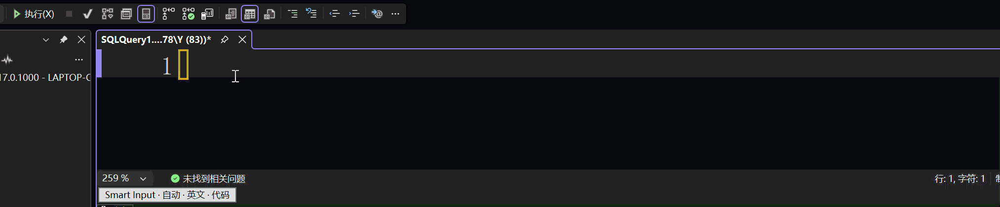

# Smart Input for Visual Studio and SSMS

面向中文开发者的本地智能输入态切换扩展：在代码、注释和字符串之间移动光标时，自动调整微软拼音或搜狗拼音的中英文状态。

作者：**我在人间做废物**（[@Ysm-04](https://github.com/Ysm-04)）

[项目主页](https://github.com/Ysm-04/SmartInput-for-Visual-Studio) · [最新版本](https://github.com/Ysm-04/SmartInput-for-Visual-Studio/releases/latest) · [全部版本](https://github.com/Ysm-04/SmartInput-for-Visual-Studio/releases) · [问题反馈](https://github.com/Ysm-04/SmartInput-for-Visual-Studio/issues) · [提交贡献](https://github.com/Ysm-04/SmartInput-for-Visual-Studio/pulls)

当前稳定版本为 **[v0.3.3](https://github.com/Ysm-04/SmartInput-for-Visual-Studio/releases/tag/v0.3.3)**。扩展完全在本地运行，不联网，不采集源码、按键或候选词。

## 快速下载

普通用户无需自行构建。请从 [最新版本页面](https://github.com/Ysm-04/SmartInput-for-Visual-Studio/releases/latest) 按宿主下载对应资产：

| 宿主 | 下载资产 | 安装方式 |
| --- | --- | --- |
| Visual Studio 2022 / 2026 | `SmartInput.VisualStudio.vsix` | 双击并通过 VSIX Installer 安装 |
| SSMS 22（2025，64 位） | `SmartInput-SSMS22.zip` | 解压后运行其中的 `Deploy-SSMS22.ps1` |
| SSMS 18 / 19 / 20（32 位） | `SmartInput-SSMS-Legacy.zip` | 解压后运行其中的 `Deploy-SSMS-Legacy.ps1` |

> 两套 SSMS 安装包不能混用。SSMS 不通过 VSIX Installer 安装第三方扩展，部署前请先阅读下文的安装说明，并优先使用 `-WhatIf` 进行只读演练。

## 导航

- [功能演示](#功能演示)
- [支持范围](#支持范围)
- [交互规则](#交互规则)
- [安装与使用](#安装与使用)
- [兼容性与已知限制](#兼容性与已知限制)
- [构建与测试](#构建与测试)
- [参与贡献](#参与贡献)

## 功能演示




## 主要功能

- 根据代码、注释、字符串等文本上下文自动选择中文或英文输入态。
- 支持 C、C++、C# 和 Transact-SQL（T-SQL）。
- 支持当前活动的微软拼音和搜狗拼音，不主动切换键盘布局或其他输入法。
- 用户手动切换后进入临时覆盖状态，不会在同一区域立即抢回输入态。
- 提供编辑器状态按钮、暂停/恢复命令、光标提示颜色和可持久化选项。
- 有选区、多光标、输入法组词或编辑器失焦时暂停自动切换。
- 不修改源代码、不自动替换标点，不联网、不采集源码或按键。

## 支持范围

| 宿主 | 位数 / Shell | 安装方式 |
| --- | --- | --- |
| Visual Studio 2022 **17.14+** / Visual Studio 2026 | x64，VSSDK 17 | 安装 `SmartInput.VisualStudio.vsix` |
| **SSMS 22（即 SSMS 2025）** | x64，基于 VS 2026 Shell | 现代包手动部署，`tools\Deploy-SSMS22.ps1` |
| **SSMS 18 / 19 / 20（即“SSMS 2022”这一代 32 位版本）** | x86，基于 VS 2017 Shell（VSSDK 15） | Legacy 包手动部署，`tools\Deploy-SSMS-Legacy.ps1` |

- 系统：Windows 10 / Windows 11；需要 .NET Framework 4.8（VS、SSMS 19/20/22 的现代安装均已满足）。
- 语言：C、C++、C# 以及 **Transact-SQL（T-SQL）** 的可编辑文档 / 查询视图。
- 输入法：当前活动的**微软拼音或搜狗拼音**。扩展只切换其内部中英文状态，不安装、添加或主动切换键盘布局，也不控制其他输入法。

> SSMS 18 及以上版本**不运行 VSIX Installer**，微软对第三方 SSMS 扩展也不提供官方安装入口。本项目按社区通行做法，把扩展文件平铺到 SSMS 的 `Common7\IDE\Extensions` 目录并清理缓存完成安装（见下文“安装与使用”）。

## 交互规则

通用规则：

| 场景 | 自动输入态 |
| --- | --- |
| 代码、字符字面量 | 英文 |
| 单行、多行、三斜线注释正文 | 中文 |
| 包含汉字的字符串文本段 | 中文 |
| 空字符串、纯英文字符串 | 英文 |
| C# 插值表达式 | 英文；表达式内部的注释/字符串单独判断 |

Transact-SQL 规则（0.3.0 新增）：

| T-SQL 场景 | 自动输入态 |
| --- | --- |
| 关键字、表名 / 列名、负数、运算符等代码 | 英文 |
| `--` 单行注释、`/* ... */` 块注释正文（块注释**支持嵌套**） | 中文 |
| 含汉字的单引号字符串 `'...'` / `N'...'`（可跨多行） | 中文 |
| 字符串内的 `''` 转义引号按同一字符串处理 | 中文 / 英文随整体内容 |
| 空字符串、纯英文字符串、仅 emoji 的字符串 | 英文 |
| `[方括号标识符]`（含 `]]` 转义），即使其中是汉字 | 英文 |
| `"双引号标识符"`：`SET QUOTED_IDENTIFIER ON`（默认）时双引号界定标识符（含 `""` 转义），即使其中是汉字 | 英文 |
| `SET QUOTED_IDENTIFIER OFF` 之后的 `"双引号字符串"`：按字符串字面量处理，含汉字推荐中文、纯英文推荐英文 | 中文 / 英文随内容 |
| 字符串内部的 `--`、`/*` 不当作注释；括号标识符内部的引号 / `--` 不当作字符串 / 注释 | 随外层区域 |

可打开仓库内的 `samples/Contexts.sql`（以及 `Contexts.cs`、`Contexts.cpp`）逐区域体验。T-SQL 没有字符字面量与字符串插值，反斜杠也不是转义符，因此单引号字符串可一直延续到闭合引号（允许跨行）。

启动时不修改系统默认输入法。第一次进入受支持编辑器时按当前场景初始化：代码为英文，注释为中文。启动页、搜索框、终端等不接管。

手动切换（包括 Shift）以**实际读到的输入态变化**为准，不拦截用户按键。搜狗输入法在普通状态写入无法确认时，仅发送一次已配置的 Shift 切换键作为兼容性恢复，并再次读取状态；微软拼音不模拟按键。偏离当前自动规则时保留手动选择并显示配置颜色光标；在同一文本区域持续输入不会立即被切回。切回推荐状态、离开该区域、切换文档或失焦后恢复自动规则。手动覆盖按文本区域而非固定秒数保持。

**不固定要求使用 Shift。** 请使用输入法设置中实际配置的中英文切换方式，例如微软拼音的 Ctrl＋空格或已启用的 Shift。如果系统没有启用 Shift，单按 Shift 不会切换，扩展也不会将它误判为手动切换。快捷键与宿主命令冲突时，以是否真正改变输入法状态为准。扩展不自动修改系统快捷键设置。

编辑器底部的 `Smart Input` 按钮显示状态；单击暂停/恢复所有文档的自动切换。在 Visual Studio 与 SSMS 22 中，暂停也可通过 `工具 > Smart Input: 暂停自动切换/恢复自动切换` 操作。**SSMS 18/19/20 的 Legacy 包不注册“工具”菜单命令**（该宿主不编译菜单资源），请使用底部状态栏按钮或选项页。暂停仅保存在当前宿主进程内，重启后恢复为未暂停。

长期设置位于 `工具 > 选项 > Smart Input > 常规`：

- 启用自动切换。
- 显示左下角状态栏。
- 手动覆盖光标颜色。
- 是否自定义状态栏文字颜色。
- 状态栏文字颜色。

安全边界：

- 组词期间不切换；有选区或多个光标时暂不切换。
- 只有本进程的编辑器获得键盘焦点时才发出切换请求。
- 每次切换后读取状态确认，600ms 未确认最多再尝试一次，仍未确认则停止当前区域内的重试。
- 搜狗输入法仅在一次状态确认失败时发送一次 Shift 恢复按键，不连续模拟，也不修改系统快捷键设置。
- 未识别出微软拼音/搜狗拼音或无法读取状态时不猜测、不操作。
- 超过 2M 字符的文件不自动分析；分析在后台进行，旧快照会取消。
- 不修改源文本，不自动替换标点；不联网、不采集源码、按键或候选词。
- 不写入“字体和颜色”或正文画刷；失焦、暂停、关闭文档时移除自定义光标装饰并恢复原生光标。

## 安装与使用

所有公开安装包均以 [Ysm-04/SmartInput-for-Visual-Studio Releases](https://github.com/Ysm-04/SmartInput-for-Visual-Studio/releases) 为准。两个 SSMS 压缩包均已包含部署脚本和对应载荷，解压后无需保留源码目录结构。

### Visual Studio 2022 / 2026

1. 从 [最新版本页面](https://github.com/Ysm-04/SmartInput-for-Visual-Studio/releases/latest) 下载 `SmartInput.VisualStudio.vsix`。
2. 双击文件并通过 VSIX Installer 选择目标 Visual Studio 实例。
3. 安装完成后重启 Visual Studio。

从源码构建时，VSIX 位于 `src/SmartInput.VisualStudio/bin/Release/SmartInput.VisualStudio.vsix`。

### SSMS 22（SSMS 2025，64 位）

1. 从 [最新版本页面](https://github.com/Ysm-04/SmartInput-for-Visual-Studio/releases/latest) 下载并解压 `SmartInput-SSMS22.zip`。
2. 可先在普通 PowerShell 中运行 `-WhatIf`，核对安装目录、缓存和备份位置。此步骤不修改系统，也无需关闭 SSMS。
3. 正式部署前完全关闭 SSMS，确认任务管理器中没有 `Ssms.exe`，再用**“以管理员身份运行”**的 PowerShell 执行安装命令。

```powershell
# 在 Release 解压目录中只读演练
powershell -ExecutionPolicy Bypass -File .\Deploy-SSMS22.ps1 -WhatIf

# 正式安装（管理员 PowerShell）
powershell -ExecutionPolicy Bypass -File .\Deploy-SSMS22.ps1

# 卸载
powershell -ExecutionPolicy Bypass -File .\Deploy-SSMS22.ps1 -Uninstall
```

从源码部署时，将脚本路径改为 `.\tools\Deploy-SSMS22.ps1`；脚本会自动使用构建产生的现代 VSIX。

脚本会把现代 VSIX（本质是 zip）解压、平铺为 SSMS 22 需要的文件到
`C:\Program Files\Microsoft SQL Server Management Studio\22\Release\Common7\IDE\Extensions\SmartInput\`，
删除 `%LocalAppData%\Microsoft\SSMS\22.0_*\` 下的 `privateregistry.bin`（含 `.LOG1/.LOG2`）与 `ComponentModelCache`，并写入 `extensions.configurationchanged` 标记。删除 `privateregistry.bin` 前会先把它自动备份到该缓存目录下的 `SmartInput-PrivateRegistry-Backup` 子目录（文件名带时间戳），需要时可用于恢复 Shell 布局。

实机部署补充（SSMS 22，已在 22.10 上验证）：

- 即使 SSMS 安装在非系统盘（如自定义的 `D:\...`），其 `Common7\IDE\Extensions` 目录仍需管理员权限写入，请始终用“以管理员身份运行”的 PowerShell 执行脚本。
- 脚本默认只自动探测 `C:\Program Files\...` 下的标准安装路径；若 SSMS 安装在自定义目录，请显式传入 IDE 目录，例如：

```powershell
powershell -ExecutionPolicy Bypass -File .\Deploy-SSMS22.ps1 -SsmsIdeDir 'D:\SQL Server Studio 22\Common7\IDE'
```

- 部署会清理 SSMS 的私有注册表与 MEF 缓存，首次重启可能需要重新确认一次界面布局；使用本地“Windows 身份验证”连接数据库引擎不需要任何 Microsoft / Azure 账号登录。

### SSMS 18 / 19 / 20（SSMS 2022 代，32 位）

1. 从 [最新版本页面](https://github.com/Ysm-04/SmartInput-for-Visual-Studio/releases/latest) 下载并解压 `SmartInput-SSMS-Legacy.zip`。
2. 可先在普通 PowerShell 中运行 `-WhatIf`，确认本机检测到的 SSMS 版本和目标路径。
3. 正式部署前完全关闭对应版本的 SSMS，再用**“以管理员身份运行”**的 PowerShell 执行安装命令。

```powershell
# 在 Release 解压目录中只读演练
powershell -ExecutionPolicy Bypass -File .\Deploy-SSMS-Legacy.ps1 -WhatIf

# 部署到检测到的所有 18/19/20 版本（管理员 PowerShell）
powershell -ExecutionPolicy Bypass -File .\Deploy-SSMS-Legacy.ps1

# 只装某一版（18 / 19 / 20）
powershell -ExecutionPolicy Bypass -File .\Deploy-SSMS-Legacy.ps1 -Version 20

# 卸载
powershell -ExecutionPolicy Bypass -File .\Deploy-SSMS-Legacy.ps1 -Uninstall
```

从源码部署时，将脚本路径改为 `.\tools\Deploy-SSMS-Legacy.ps1`。

脚本把 Legacy 负载平铺到
`C:\Program Files (x86)\Microsoft SQL Server Management Studio {18|19|20}\Common7\IDE\Extensions\SmartInput\`，
并清理 `%LocalAppData%\Microsoft\SQL Server Management Studio\{版本}.0_IsoShell\` 下的私有注册表与 MEF 缓存。SSMS 只扫描 Program Files 下的全局扩展目录，不扫描当前用户目录；删除私有注册表前会先自动备份到 `SmartInput-PrivateRegistry-Backup`。

### 安装后检查

- `工具 > 选项 > Smart Input > 常规` 是否存在。
- Visual Studio / SSMS 22 的 `工具` 菜单中是否存在 Smart Input 暂停命令（SSMS 18-20 无此菜单，属预期）。
- 打开 C/C++、C# 或 `.sql` 文件后，编辑器底部是否出现 `Smart Input` 状态按钮。
- 在 `.sql` 窗口中，左下角状态条随光标位置变化：代码与 `[标识符]` / `"标识符"` 区域显示“英文 · 代码”，`--`、`/* */` 注释与含汉字字符串显示“中文 · 注释 / 字符串”。在 SSMS 22 + 搜狗拼音下实测，移动光标即会自动切换到对应中 / 英文态，手动按 Shift 也可正常切换，与推荐态不符时输入光标变为提示色。

若扩展未出现，请确认部署前 SSMS 已完全关闭、缓存文件确实被删除；也可用 `Ssms.exe -log` 启动并在 `%AppData%\Microsoft\SSMS\<版本>\ActivityLog.xml` 中检索错误。从浏览器下载的压缩包解压后如遇“已阻止加载网络位置程序集”，对扩展目录执行 `Get-ChildItem <扩展目录> -Recurse | Unblock-File`（部署脚本已自动处理）。

## 代码结构

- `src/SmartInput.Core`：无外部依赖的词法边界分析与手动覆盖状态机。`ContextAnalysis.cs` 内按语言分流，T-SQL 扫描规则与 C/C++、C# 并列。
- `src/SmartInput.VisualStudio`：现代包（VSSDK 17，x64）。MEF 编辑器接入、选项页、工具菜单命令、后台快照分析、微软拼音/搜狗拼音状态读写、临时光标颜色、状态栏按钮；同时目标 Visual Studio 与 SSMS 22。
- `src/SmartInput.Ssms.Legacy`：SSMS 18/19/20 的 32 位包（VSSDK 15，net48，AnyCPU）。用 `<Compile Link>` 共享 `SmartInput.VisualStudio` 的全部源码，仅引用 VSSDK 15 程序集；`SmartInput.VisualStudio.pkgdef` 与 v1 `extension.vsixmanifest` 为手写维护。
- `tests/SmartInput.Tests`：可直接运行的控制台测试程序，失败返回非零退出码。
- `samples/Contexts.sql`、`Contexts.cs`、`Contexts.cpp`：编辑器交互检查样例（不参与构建）。
- `tools/Deploy-SSMS22.ps1` / `tools/Deploy-SSMS-Legacy.ps1`：SSMS 手动部署 / 卸载与缓存清理；支持 `-WhatIf` 只读演练，删除私有注册表前自动备份。
- `tools/Pack-Release.ps1`：构建后收集产物，生成供 GitHub Release 上传的 `SmartInput-SSMS22.zip` 与 `SmartInput-SSMS-Legacy.zip`。
- `tools/Verify-Package.ps1` / `tools/Verify-LegacyPackage.ps1`：分别校验现代 VSIX 与 Legacy 负载，不加载或安装扩展。
- `docs/MANUAL-TESTS.md`：安装前提、实机验证步骤和回归项目。
- `docs/VALIDATION.md`：验证结果、兼容性和已知边界。
- `docs/RELEASE-NOTES.md`：发布说明和版本变化。
- `docs/PRIVACY.md`：本地处理与隐私边界说明。
- `tools/Inspect-Pinyin.ps1`、`tools/Inspect-InputMethods.ps1`：Windows PowerShell 5.1 下的只读检查，不执行输入态切换。
- `docs/CARET-FIX.md`：手动覆盖光标装饰层的技术原因、实现方式和验证边界。

后台词法扫描器负责引号、注释和插值的边界分析，VS 语法分类辅助排除非活动代码；它不是完整编译器。T-SQL 部分覆盖注释、单引号字符串、括号标识符与双引号定界内容的常见写法；双引号按文本中出现的 `SET QUOTED_IDENTIFIER ON/OFF` 顺序判定（默认 ON：双引号为标识符；OFF：双引号为字符串）。由于 `QUOTED_IDENTIFIER` 本质是连接 / 批处理 / 运行时设置，存储过程、触发器内或跨 `GO` 批处理中由运行时决定、静态文本无法确定的取值，仍按默认 ON 处理；非常见的宿主专有语法也可能存在识别偏差。分类信息尚未更新时，可能暂时按词法结果判断。

## 构建与测试

构建需要 MSBuild（Visual Studio 2022 17.14+ 或兼容版本）和 .NET Framework 4.8 目标包。**不需要单独安装 .NET SDK，也不要求预装 Visual Studio 扩展开发工作负载**；VSSDK 17、VSSDK 15 和 VSIX 构建依赖由 NuGet 还原到项目的 `.packages` 目录。

```powershell
# 还原、Release 构建、运行测试并校验两套包
.\build.ps1 -Configuration Release

# 已还原依赖时可离线构建
.\build.ps1 -Configuration Release -SkipRestore

# 也可显式指定 MSBuild
.\build.ps1 -Configuration Release -MSBuildPath 'C:\Path\To\MSBuild.exe'
```

脚本不会安装扩展、启动 Visual Studio / SSMS 或修改系统输入法。一次构建会产生两套不可互换的二进制：

- 现代包（x64，VSSDK 17）：`src/SmartInput.VisualStudio/bin/Release/SmartInput.VisualStudio.vsix`，用于 Visual Studio 2022/2026 与 SSMS 22。
- Legacy 包（AnyCPU，绑定 VSSDK 15）：`src/SmartInput.Ssms.Legacy/bin/Release/`，用于 32 位 SSMS 18/19/20。

`tools/Verify-Package.ps1` 校验现代 VSIX，`tools/Verify-LegacyPackage.ps1` 校验 Legacy 负载。制作发布附件时运行：

```powershell
.\tools\Pack-Release.ps1 -Build
```

生成的 `SmartInput-SSMS22.zip` 和 `SmartInput-SSMS-Legacy.zip` 位于 `artifacts/`。完整验证记录见 [docs/VALIDATION.md](docs/VALIDATION.md)，实机回归项目见 [docs/MANUAL-TESTS.md](docs/MANUAL-TESTS.md)。

## 兼容性与已知限制

v0.3.3 发布记录包含 143 项自动化测试、现代 VSIX 校验和 Legacy 负载校验。该结果是对应发布提交的验证快照；仓库当前未配置 GitHub Actions，因此不能代替每次提交后的持续集成检查。

| 环境 | 当前验证状态 |
| --- | --- |
| Visual Studio 2022 / 2026，C/C++/C#，微软拼音与搜狗拼音 | 已完成既有功能实机验证 |
| SSMS 22.10 / Windows 11 / 搜狗拼音 | 部署、MEF 加载、菜单、状态栏、T-SQL 上下文、自动切换和手动 Shift 覆盖均已实测通过 |
| SSMS 22 / 微软拼音 | 尚未完成同项实机验证 |
| SSMS 18 / 19 / 20 Legacy 包 | 包结构已校验，宿主加载和输入法行为尚待实机验证 |
| Visual Studio 的 T-SQL 编辑器 | 建议继续补充实机验证 |

完整环境、证据与验证边界见 [验证记录](docs/VALIDATION.md)，复测时请使用 [实机回归清单](docs/MANUAL-TESTS.md)。

Windows 的输入态可能受“每个应用窗口使用不同输入法”等系统选项影响。扩展会限制自己的调用范围，但无法保证离开宿主后 Windows 不继承原输入态。SSMS 18/19/20 的 Legacy 包不提供“工具”菜单暂停命令，请使用状态栏按钮或选项页。

以下范围不属于当前支持承诺：

- SSMS 22 的 ARM64 原生扩展（当前为 amd64 目标，可在 x64 / x64 仿真环境使用）。
- 微软拼音旧版兼容模式。
- C++ 预处理器复杂分支/拼接、C# 插值格式段、T-SQL 宿主专有方言和不完整语法的全部边界。

## 项目由来与贡献者

Smart Input 源于中文开发者在代码、注释和字符串之间频繁切换输入法的实际痛点：手动切换容易打断思路，也可能把半角标点误输为全角标点。本项目独立设计与实现，只参考 Smart Input Pro (Chinese) 的交互思路，不包含对方的代码、资源、授权或收费系统。

项目由 [Di-Y](https://github.com/Di-Y) 提出产品设想和功能构想，前期由 **我在人间做废物** 完成 Visual Studio 版本的主要实现。版本分工如下：

| 版本 | 主要贡献 |
| --- | --- |
| 0.1.x – 0.2.x | **我在人间做废物**：实现 Visual Studio 上 C/C++/C# 的自动中英文态切换；Di-Y 提供需求意见与功能构想 |
| 0.3.0 | **Di-Y**：新增 T-SQL、SSMS 18/19/20/22 支持及现代包 + Legacy 双包结构 |
| 0.3.1 | **Di-Y**：修复无独立 .NET SDK 环境下的构建流程，完善 SSMS 部署与加载兼容性 |
| 0.3.2 | **Di-Y**：补齐发布载荷、部署脚本安全、Release 测试配置和 `QUOTED_IDENTIFIER` 处理 |
| 0.3.3 | **Di-Y**：统一发布标签、构建提交与三份发布资产，无功能行为变更 |

具体变更以 Git 提交记录和 [发布说明](docs/RELEASE-NOTES.md) 为准。

## 参与贡献

1. 通过本仓库的 [Issues](https://github.com/Ysm-04/SmartInput-for-Visual-Studio/issues) 报告缺陷或提出建议，并附上系统、宿主、扩展和输入法版本，以及复现步骤与实际表现。
2. Fork 仓库后在独立分支修改，通过 [Pull Requests](https://github.com/Ysm-04/SmartInput-for-Visual-Studio/pulls) 提交，并说明动机、改动和验证方式。
3. 提交前运行 `.\build.ps1 -Configuration Release`，确认当前自动化测试、现代 VSIX 和 Legacy 负载校验全部通过。
4. 不要提交 `.packages`、`bin`、`obj`、`.vs` 等还原或构建产物；新增第三方依赖时须注明来源与许可证。
5. 遵守项目的[隐私边界](docs/PRIVACY.md)：不联网、不采集源码或按键、不自动替换标点。

反馈时请勿上传私人源码、候选词或完整键盘记录。署名或贡献描述需要调整时，也请通过本仓库的 Issue 或 Pull Request 提出。

## 许可证

作者：**我在人间做废物**（[@Ysm-04](https://github.com/Ysm-04)）。

本项目采用 [MIT License](LICENSE)。除许可证文本中规定的条件外，使用、修改、分发本项目不附加额外限制。项目依赖遵循各自许可证，不代表本项目许可证覆盖第三方代码、商标或资源。

提交代码或文档时，请确保提交内容由提交者拥有相应权利，或已取得必要授权；新增第三方依赖时，请同时说明其来源和许可证。

问题反馈请提交到本仓库的 [Issues](https://github.com/Ysm-04/SmartInput-for-Visual-Studio/issues)，并提供系统版本、Visual Studio / SSMS 版本、扩展版本、输入法版本、操作步骤和实际表现。

参考：[SSMS 版本与扩展兼容说明](https://learn.microsoft.com/sql/ssms/sql-server-management-studio-changelog-ssms)、[VS 2026 扩展兼容模型](https://learn.microsoft.com/zh-cn/visualstudio/extensibility/migration/extension-compatibility?view=visualstudio)、[VS 光标格式接口](https://learn.microsoft.com/en-us/visualstudio/extensibility/walkthrough-customizing-the-text-view?view=vs-2022)、[WPF InputMethod](https://learn.microsoft.com/en-us/dotnet/api/system.windows.input.inputmethod?view=netframework-4.8)。SSMS 手动部署与缓存清理的实现参考了开源项目 [mourier/sql-pilot](https://github.com/mourier/sql-pilot) 的集成笔记。
